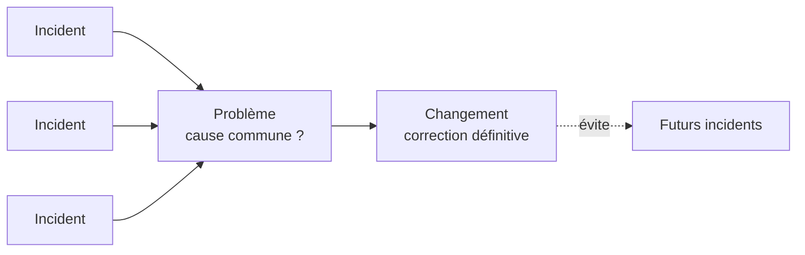

[Sommaire](Readme.md) · [Chapitre suivant →](02-Le-centre-de-services.md)

# ITIL : concepts et vocabulaire

## 🎯 Objectifs du chapitre

- Présenter ITIL et ses objectifs
- Maîtriser la terminologie ITIL
- Prioriser un ticket avec la matrice des priorités
- Distinguer les quatre types de tickets

---

## 1. Qu'est-ce qu'ITIL ?

**ITIL** (*IT Infrastructure Library*, bibliothèque d'infrastructures IT)
est un ensemble de documents qui structurent et décrivent les **bonnes
pratiques** de la gestion des services informatiques (**ITSM**).

Le référentiel est apparu dans les années 1980, au moment où la plupart des
entreprises entamaient leur transformation numérique. Il aborde notamment :

- l'organisation du système d'information ;
- l'amélioration de l'efficacité et de la qualité des services informatiques ;
- la gestion des risques.

> 💡 ITIL est un référentiel de **bonnes pratiques**, pas une norme : chaque
> organisation l'adapte à sa taille et à son contexte. La version actuelle
> est ITIL 4.

---

## 2. Terminologie

ITIL définit les termes et outils communs à la plupart des services IT.

| Terme | Définition |
|---|---|
| **CI** — *Configuration Item* | Élément de configuration : utilisateur, PC, switch, logiciel… |
| **CMDB** — *Configuration Management Database* | Base de données qui gère les informations et les configurations des CI, et leurs relations |
| **KB** — *Knowledge Base* | Base de connaissances, qui augmente l'efficacité et l'autonomie des équipes |
| **SLA** — *Service Level Agreement* | Engagement mesurable de niveau de service : disponibilité, délai de prise en compte, délai de résolution… |
| **Backlog** | Ensemble des tickets affectés à une entité (centre de services, équipe N1, N2, N3…) ; désigne aussi l'écran qui les affiche |

---

## 3. La matrice des priorités

La matrice des priorités détermine la priorité d'une tâche par rapport à une
autre, en croisant deux critères.

| Critère | Ce qu'il mesure | Échelle type |
|---|---|---|
| **Urgence** | le temps que peut mettre un incident à avoir des répercussions négatives sur l'activité | très urgent, urgent, non urgent |
| **Impact** (ou criticité) | l'ampleur des conséquences potentielles sur l'activité | critique, moyen, bas |

La **priorité** naît du croisement des deux ; c'est l'indicateur qui ordonne
les tâches.

| Urgence ＼ Impact | Faible | Moyen | Élevé |
|---|---|---|---|
| **Faible** | P5 | P4 | P3 |
| **Moyenne** | P4 | P3 | P2 |
| **Élevée** | P3 | P2 | **P1** |

### Les niveaux de service

Le niveau de service fixe, par contrat, les engagements de **prise en compte**
et de **résolution** d'un ticket selon sa priorité. Il varie selon le client
et le contrat. Exemple :

| Priorité | Réponse sous | Résolution sous |
|---|---|---|
| **P1** — majeure | 15 min | 2 h |
| **P2** — élevée | 15 min | 4 h |
| **P3** — normale | 1 h | 2 jours |
| **P4** — basse | 4 h | 5 jours |
| **P5** — planifiable | 1 jour | 2 semaines |

---

## 4. Les types de tickets

| Type | Définition | Exemple |
|---|---|---|
| **Incident** | Événement non souhaité qui interrompt un service ou en dégrade la qualité | « L'imprimante du 2ᵉ étage ne répond plus » |
| **Demande** (*request*) | Sollicitation d'un utilisateur dans un cadre prédéfini, le **catalogue de services** | « J'ai besoin d'un accès au dossier Comptabilité » |
| **Problème** | Cause profonde, inconnue, d'un ou de plusieurs incidents | « Le VPN décroche tous les jours vers 10 h pour plusieurs utilisateurs » |
| **Changement** | Ajout, modification ou suppression d'un service ou d'un de ses composants | « Migration du serveur de messagerie » |

---

## ✅ Vérifier ses acquis

1. Un incident a un impact élevé et une urgence moyenne. Quelle priorité ?
2. Un utilisateur demande l'installation d'un logiciel du catalogue. Incident ou demande ?
3. Quelle différence entre un incident et un problème ?

Voir la correction

1. P2.
2. Une demande : elle s'inscrit dans le catalogue de services, rien n'est cassé.
3. L'incident est le symptôme (un service interrompu ou dégradé) ; le problème est la cause profonde, inconnue, d'un ou de plusieurs incidents.

---

[Sommaire](Readme.md) · [Chapitre suivant →](02-Le-centre-de-services.md)
