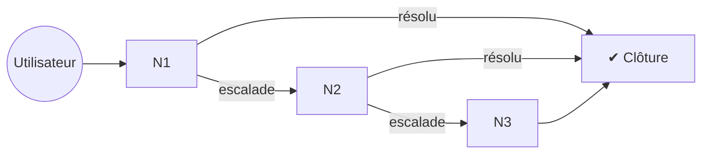
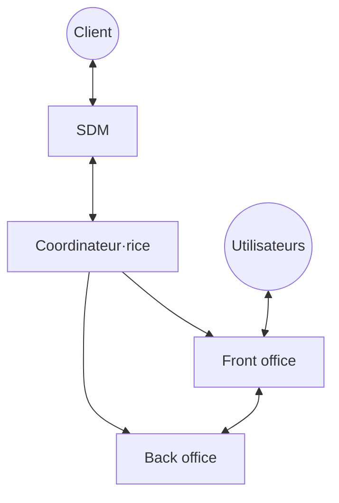
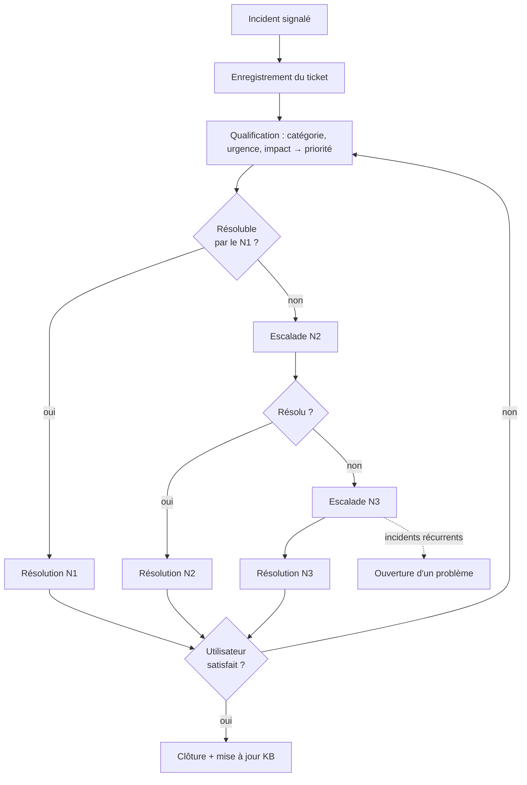

[← Chapitre précédent](01-ITIL-concepts.md) · [Sommaire](Readme.md) · [Chapitre suivant →](03-ITSM-et-solutions.md)

# Le centre de services

## 🎯 Objectifs du chapitre

- Décrire les niveaux de support et la notion d'escalade
- Connaître les responsabilités du centre de services
- Distinguer les rôles : front office, back office, coordinateur, SDM
- Dérouler le processus de gestion d'un incident

---

## 1. Les niveaux de support

Les centres de services informatiques sont généralement organisés en
plusieurs niveaux de support. Chaque niveau est piloté par un coordinateur
technique, parfois appuyé par un ou plusieurs chefs de projet pour les
changements majeurs.

| Niveau | Composition | Missions |
|---|---|---|
| **N1** | techniciens, administrateurs juniors | pannes et incidents non bloquants, demandes simples, accompagnement des utilisateurs |
| **N2** | administrateurs, ingénieurs juniors | incidents bloquants, demandes et changements simples |
| **N3** | administrateurs confirmés, ingénieurs, experts techniques, architectes | incidents et problèmes bloquants majeurs, demandes et changements qui exigent une expertise |

### L'escalade

L'**escalade** consiste à transférer un ticket à une équipe technique ou
managériale de niveau supérieur.

---

## 2. Le centre de services

Le centre de services (*Service Desk*) joue un rôle essentiel dans la gestion
des tickets. Ses responsabilités :

- **accueil et assistance** : réception des demandes et incidents des utilisateurs ;
- **enregistrement et suivi** des tickets ;
- **diagnostic et classification** des demandes ;
- **escalade** vers les équipes compétentes, pour éviter les blocages ;
- **communication** avec les utilisateurs sur l'avancement et la résolution ;
- **clôture et validation** des tickets, après confirmation de la satisfaction de l'utilisateur ;
- **historique** des incidents, pour améliorer leur traitement futur.

---

## 3. Les rôles

### Front office — support de premier niveau

- point de contact principal entre les utilisateurs et le support IT ;
- répond aux appels, courriels et messages instantanés ;
- prend en charge les demandes et incidents simples (réinitialisation de mot de passe…) ;
- transmet les autres tickets aux équipes concernées selon leur type : back office, N1, N2, N3.

### Back office — support technique avancé

- techniciens et administrateurs qui traitent les différents types de tickets ;
- analyse des causes profondes et mise en place de solutions durables ;
- intervention sur les périphériques, infrastructures, serveurs et applications ;
- appui au front office sur les incidents qui exigent une expertise ;
- amélioration continue : documentation des solutions, optimisation des processus.

### Coordinateur·rice

- organise et suit les tickets de son équipe ;
- garantit la communication entre les équipes techniques et les utilisateurs ;
- veille à l'application des bonnes pratiques ITIL ;
- **priorise, attribue et escalade** les tickets pour respecter les SLA ;
- produit rapports et analyses pour améliorer la qualité de service ;
- interlocuteur privilégié du SDM.

### SDM — Service Delivery Manager

- responsable de la relation client et de la livraison des services IT ;
- garant du respect des SLA et de la satisfaction des utilisateurs ;
- coordonne les équipes internes et externes ;
- pilote l'amélioration continue grâce aux indicateurs de performance ;
- fait le lien entre les clients et les équipes techniques.

---

## 4. La gestion des incidents

### Les étapes clés

1. Détection et enregistrement de l'incident
2. Qualification et assistance initiale
3. Affectation et escalade
4. Enquête et diagnostic
5. Traitement, résolution et restauration du service — ou solution de contournement
6. Clôture de l'incident
7. Compte rendu de traitement

Tout au long du processus : **suivi et communication** au demandeur. À la
fin : **mise à jour de la base de connaissances**.

### Le logigramme de gestion

Le logigramme de gestion des incidents est défini à partir des bonnes
pratiques ITIL, puis adapté à l'organisation et à l'outil d'ITSM (ServiceNow,
GLPI, Jira…). Sa conception et sa mise à jour reviennent généralement au
responsable du centre de services ou aux managers des équipes N1/N2/N3.

Exemple de logigramme de résolution :

---

## ✅ Vérifier ses acquis

1. Qui priorise et attribue les tickets pour respecter les SLA ?
2. Un utilisateur a oublié son mot de passe. Quel rôle traite la demande ?
3. Quelle étape clôt le traitement d'un incident, après la clôture du ticket ?

Voir la correction

1. Le ou la coordinateur·rice.
2. Le front office, directement.
3. La mise à jour de la base de connaissances (et le compte rendu de traitement).

---

[← Chapitre précédent](01-ITIL-concepts.md) · [Sommaire](Readme.md) · [Chapitre suivant →](03-ITSM-et-solutions.md)
