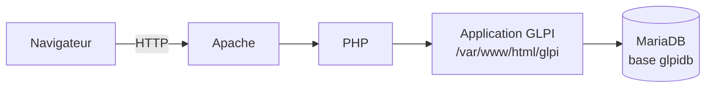

[← Chapitre précédent](03-ITSM-et-solutions.md) · [Sommaire](Readme.md) · [Chapitre suivant →](05-GLPI-utilisation.md)

# GLPI : installation

## 🎯 Objectifs du chapitre

- Installer une pile LAMP sur Debian
- Préparer la base de données de GLPI
- Déployer GLPI et finaliser son installation
- Se connecter avec les comptes par défaut, puis les sécuriser

---

## 1. Vue d'ensemble

GLPI est une application web PHP : elle s'installe sur une pile **LAMP** —
**L**inux, **A**pache, **M**ySQL/MariaDB, **P**HP.



---

## 2. Installer la pile LAMP

1. Installer un serveur **Debian**.
2. Configurer le réseau et l'accès SSH.
3. Vérifier que les dépôts officiels sont déclarés dans `/etc/apt/sources.list` :

```text
deb http://deb.debian.org/debian stable main contrib non-free
```

4. Mettre à jour les paquets :

```bash
apt update && apt upgrade -y
```

5. Installer Apache, PHP et MariaDB, ainsi que les extensions PHP dont GLPI a besoin :

```bash
apt install -y apache2 php libapache2-mod-php
apt install -y php-mysql php-ldap php-imap php-curl php-gd php-intl \
               php-mbstring php-xml php-zip php-bz2 php-apcu php-cas
apt install -y mariadb-server
```

> 💡 La liste exacte des extensions requises dépend de la version de GLPI :
> elle est rappelée dans la documentation d'installation, et vérifiée par
> l'assistant web à l'étape 4.

6. Sécuriser MariaDB (mot de passe root, suppression des comptes anonymes et de la base de test) :

```bash
mysql_secure_installation
```

7. Redémarrer les services :

```bash
systemctl restart mariadb
systemctl restart apache2
```

---

## 3. Créer la base de données

Se connecter à MariaDB :

```bash
mysql -u root -p
```

Créer la base `glpidb` et l'utilisateur `glpiuser`, qui y aura tous les
droits :

```sql
CREATE DATABASE glpidb CHARACTER SET utf8mb4 COLLATE utf8mb4_unicode_ci;
CREATE USER 'glpiuser'@'localhost' IDENTIFIED BY 'MotDePasseRobuste!';
GRANT ALL PRIVILEGES ON glpidb.* TO 'glpiuser'@'localhost';
FLUSH PRIVILEGES;
QUIT;
```

> ⚠️ Choisissez un vrai mot de passe : le `pass` des tutoriels finit
> régulièrement en production.

Optionnel : installer **phpMyAdmin** pour administrer la base depuis un
navigateur.

```bash
apt install -y phpmyadmin
```

---

## 4. Installer GLPI

Télécharger l'archive, l'extraire dans la racine web et donner les droits à
Apache. Récupérez d'abord le numéro de la **dernière version** sur la page
des *releases* GitHub :

```bash
GLPI_VERSION=10.0.18     # à adapter : dernière version publiée
cd /usr/src/
wget https://github.com/glpi-project/glpi/releases/download/${GLPI_VERSION}/glpi-${GLPI_VERSION}.tgz
tar -xvzf glpi-${GLPI_VERSION}.tgz -C /var/www/html
chown -R www-data:www-data /var/www/html/glpi/
```

Finaliser l'installation depuis un navigateur :

```text
http://IP_DU_SERVEUR/glpi
```

L'assistant vérifie les prérequis, demande les paramètres de connexion à la
base (`localhost`, `glpiuser`, son mot de passe, base `glpidb`) puis crée les
tables.

### Corriger les erreurs courantes

Si l'assistant signale un problème d'accès aux fichiers (`.htaccess` ignoré),
autoriser la surcharge de configuration dans `/etc/apache2/apache2.conf` :

```bash
vi /etc/apache2/apache2.conf
```

```apache
<Directory /var/www/>
    Options Indexes FollowSymLinks
    AllowOverride All
    Require all granted
</Directory>
```

Puis redémarrer Apache :

```bash
systemctl restart apache2
```

---

## 5. Première connexion

URL : `http://IP_DU_SERVEUR/glpi`

| Identifiant / mot de passe | Profil |
|---|---|
| `glpi` / `glpi` | administrateur |
| `tech` / `tech` | technicien |
| `normal` / `normal` | utilisateur normal |
| `post-only` / `postonly` | utilisateur *post-only* (création de tickets uniquement) |

> ⚠️ Dès la première connexion : **changer les mots de passe** de ces quatre
> comptes (ou désactiver ceux qui ne servent pas), et **supprimer le fichier**
> `install/install.php`. GLPI affiche un bandeau d'alerte tant que ce n'est
> pas fait.

---

## ✅ Exercice

Sur une VM Debian, installez GLPI en suivant ce chapitre, puis :

1. connectez-vous en `glpi` ;
2. changez les mots de passe des quatre comptes par défaut ;
3. vérifiez que le bandeau d'alerte de sécurité a disparu.

<details>
<summary>Indices en cas de blocage</summary>

- Page blanche ou erreur 500 : consultez `/var/log/apache2/error.log`.
- Extension PHP manquante signalée par l'assistant : installez le paquet `php-<extension>` correspondant, puis `systemctl restart apache2`.
- Connexion à la base refusée : vérifiez l'utilisateur et son mot de passe avec `mysql -u glpiuser -p glpidb`.

</details>

---

[← Chapitre précédent](03-ITSM-et-solutions.md) · [Sommaire](Readme.md) · [Chapitre suivant →](05-GLPI-utilisation.md)
