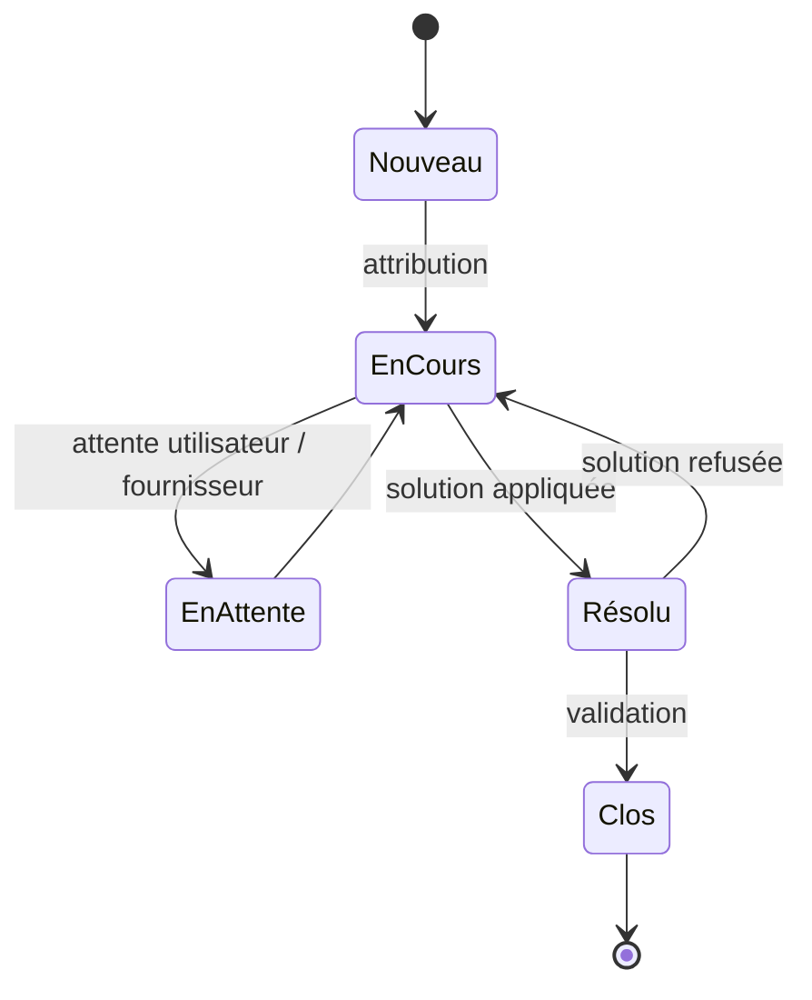
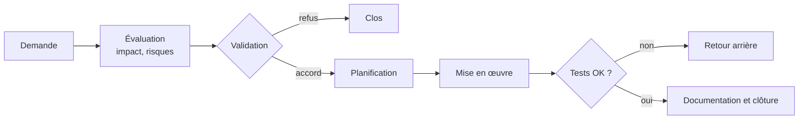

[← Chapitre précédent](04-GLPI-installation.md) · [Sommaire](Readme.md)

# GLPI : utilisation

## 🎯 Objectifs du chapitre

- Créer, suivre et clôturer un ticket d'incident
- Gérer un problème et en analyser les causes
- Conduire une demande de changement

---

## 1. Accéder à GLPI

1. Ouvrir un navigateur et accéder à l'URL de GLPI.
2. Saisir son identifiant et son mot de passe.
3. Cliquer sur **Connexion**.
4. Accéder à l'interface d'administration, si l'on dispose des droits nécessaires.

---

## 2. Les tickets d'incident

### Cycle de vie d'un ticket

### Créer un ticket

1. Aller dans **Assistance > Tickets**.
2. Cliquer sur **Créer un ticket**.
3. Renseigner :
   - **Demandeur** : l'utilisateur affecté par l'incident ;
   - **Catégorie** : nature de l'incident (matériel, logiciel, réseau…) ;
   - **Description** : explication détaillée du problème ;
   - **Urgence / impact**, d'où découle la **priorité** ;
   - **Pièces jointes** : captures d'écran, documents utiles ;
   - **Lieu** : emplacement physique concerné, si nécessaire ;
   - **Groupe d'affectation** : si plusieurs techniciens doivent intervenir.
4. Cliquer sur **Enregistrer**.

### Suivre et mettre à jour un ticket

1. Accéder à la liste des tickets.
2. Rechercher le ticket via le moteur de recherche.
3. Ouvrir le ticket pour afficher ses détails.
4. Mettre à jour :
   - ajouter des **suivis** pour tenir l'utilisateur informé ;
   - modifier le **statut** (en cours, en attente, résolu) ;
   - **attribuer** à un technicien ou à un groupe ;
   - ajouter une **solution** temporaire ou définitive ;
   - saisir les **temps** d'intervention.
5. Enregistrer.

### Clôturer un ticket

- vérifier que la solution a bien été appliquée ;
- demander la validation de l'utilisateur ;
- passer le statut en **Résolu** ;
- ajouter un commentaire final décrivant la solution ;
- archiver le ticket si nécessaire ;
- cliquer sur **Clore**.

---

## 3. Les problèmes

1. Aller dans **Assistance > Problèmes**.
2. Créer un problème en renseignant :
   - une description détaillée ;
   - la liste des **incidents liés** ;
   - l'**analyse des causes** : méthode des 5 pourquoi, diagramme d'Ishikawa… ;
   - les éventuelles **solutions de contournement**.
3. Enregistrer, puis suivre l'évolution du problème.
4. Proposer et mettre en œuvre une **correction définitive**.
5. Documenter la solution dans la **base de connaissances**.
6. Clore le problème une fois résolu.

### La méthode des 5 pourquoi

On remonte à la cause racine en demandant « pourquoi ? » à chaque réponse :

| Question | Réponse |
|---|---|
| Pourquoi les utilisateurs ne peuvent-ils plus imprimer ? | Le serveur d'impression ne répond plus |
| Pourquoi ne répond-il plus ? | Son disque système est plein |
| Pourquoi est-il plein ? | Les journaux d'impression ne sont jamais purgés |
| Pourquoi ne sont-ils pas purgés ? | Aucune rotation des journaux n'est configurée |
| Pourquoi ? | Elle a été oubliée dans la procédure d'installation |

→ Correction définitive : configurer la rotation des journaux **et** mettre à jour la procédure.

---

## 4. Les demandes de changement

1. Aller dans **Assistance > Changements**.
2. Cliquer sur **Ajouter**.
3. Renseigner :
   - la **justification** du changement ;
   - l'**impact** attendu, sur les utilisateurs comme sur l'infrastructure ;
   - le **plan d'action** détaillé et son échéancier ;
   - les **risques** et le **plan de retour arrière**.
4. Faire valider par les responsables concernés.
5. Planifier, puis exécuter le changement.
6. Réaliser les **tests** post-implémentation.
7. Documenter les actions réalisées et les impacts observés.
8. Suivre et valider les résultats avant la clôture.

---

## ✅ Exercice

Dans votre instance GLPI :

1. créez trois tickets d'incident « Le VPN se déconnecte » pour trois utilisateurs différents ;
2. créez un problème qui leur est lié, et menez une analyse des 5 pourquoi plausible ;
3. créez la demande de changement qui corrige la cause racine, avec son plan de retour arrière ;
4. résolvez et clôturez l'ensemble, puis rédigez l'article de base de connaissances correspondant.

---

[← Chapitre précédent](04-GLPI-installation.md) · [Sommaire](Readme.md)
